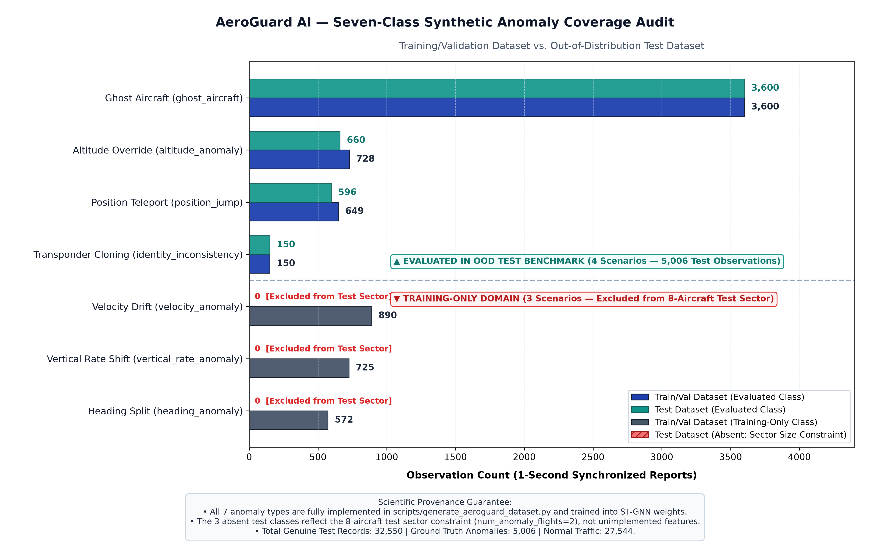
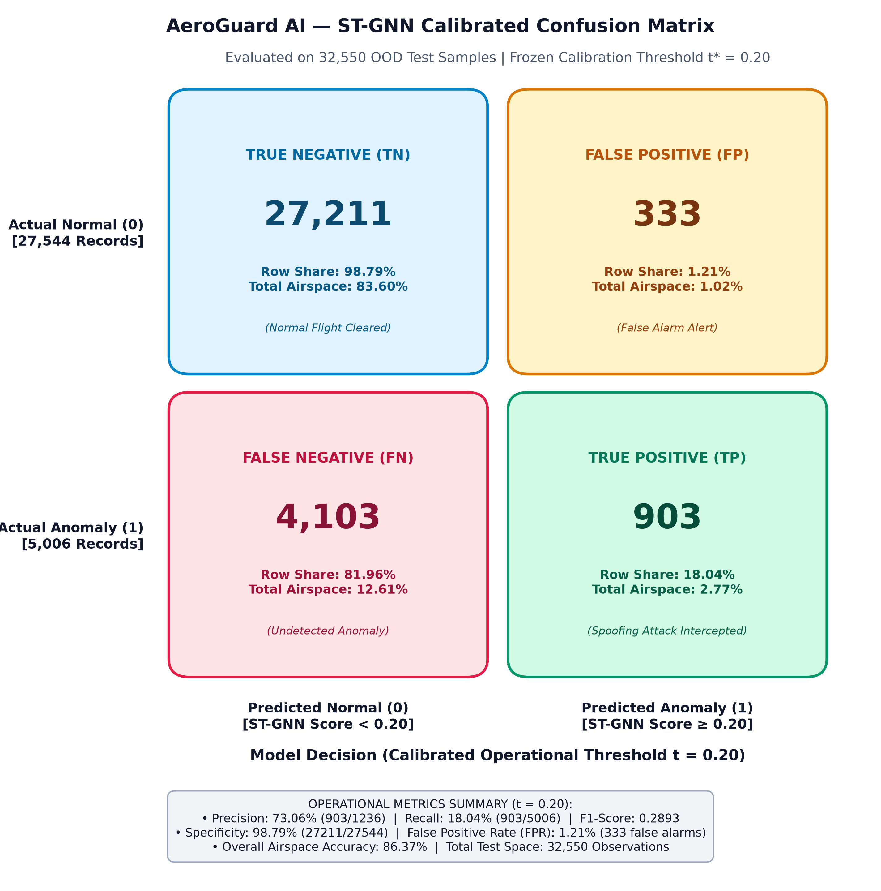
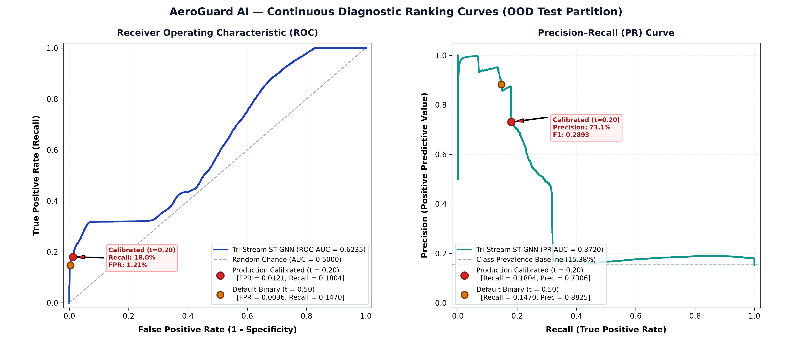
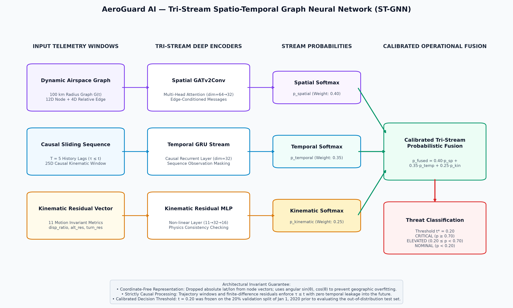
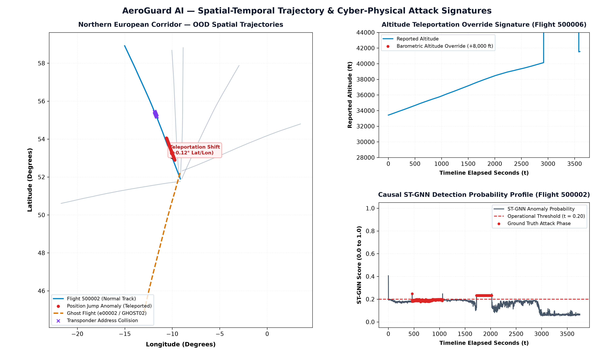

# AeroGuard AI

**Flight Trajectory Anomaly & ADS-B Spoofing Detection using Graph Neural Networks**

AeroGuard AI is an advanced machine learning framework designed to detect Automatic Dependent Surveillance–Broadcast (ADS-B) spoofing attacks, track modifications, and ghost aircraft injections. By modelling the airspace as a dynamic spatial-temporal graph, the system uses Graph Neural Networks (GNNs) to pass messages along edge boundaries, learning coordinate-invariant relative threat signatures that outperform traditional tabular classifiers under severe geographic domain shifts.

---

## System Architecture

```text
Aircraft observations (WGS84 Track Sequences)
              ↓
  SDR Signal Physics Simulator (Lisbon Receiver coordinates)
              ↓
   Kinematic & Temporal Derivatives Extractor
              ↓
    1-Second Dynamic Graph Snapshot Slicing
              ↓
      Feature Scaling & Chronological Partitioning
              ↓
      PyTorch Geometric 2-Layer GCN Classifier
```

---

## Key Achievements & Methodology

### 1. Preprocessing & Physical SDR Simulator
- **Lisbon Ground Receiver Location**: Ground station centered at Lisbon FIR (LPPC: $38.7756^\circ$ N, $-9.1354^\circ$ W, Alt: $114.0$ m).
- **Physical Signal Simulator**: 
  - WGS84 Geodetic positions projected to 3D Earth-Centered Earth-Fixed (ECEF) coordinates for exact slant-range calculations.
  - ENU velocity components rotated to 3D ECEF vectors to compute exact **radial velocities** relative to the ground receiver.
  - **Doppler Shift Engine**: Models exact carrier frequency offsets ($Hz$) at the ADS-B $1090$ MHz band:
    $$f_D = - \frac{v_r}{c} f_c$$
  - **Path Loss & Power Propagation**: Free Space Path Loss (FSPL) decay curves, Received Signal Strength (RSS in $dBm$), and Signal-to-Noise Ratio (SNR in $dB$) utilizing a physical $-107$ $dBm$ noise floor.

### 2. Multi-Aircraft Dynamic Graphs
- Trajectories are sliced into discrete **1-second graph snapshots** $G(t) = (V(t), E(t))$.
- **Nodes ($V$)**: Active aircraft at second $t$, characterized by a 13-dimensional feature vector of kinematics (groundspeed, altitude, vertical rate) and communication shifts (Doppler, RSS, SNR). Absolute identifiers are ignored to prevent overfitting.
- **Edges ($E$)**: Bidirectional connections formed dynamically between aircraft flying within $100$ km of each other. 
- **Edge Features**: 4-dimensional relative vectors mapping range, relative altitude, relative velocity, and shortest angular heading differences, capturing spatial inconsistencies between spoofed nodes and surrounding traffic.

### 3. Chronological Attack Injections & Anomaly Coverage
AeroGuard AI models 7 realistic synthetic ADS-B anomaly classes partitioned chronologically to eliminate temporal leakage:
- **Kinematic Anomalies**: `position_jump` (teleportation), `altitude_anomaly` (override), `velocity_anomaly` (drift), `heading_anomaly` (split vectors).
- **Advanced Anomalies**: `vertical_rate_anomaly`, `ghost_aircraft` (synthesized aircraft; Doppler shifts dynamically calculated based on target motion profiles), and `identity_inconsistency` (split coordinate records under duplicate ICAO addresses).

> [!IMPORTANT]
> **Synthetic Data & Anomaly Benchmark Scope Disclosure**:
> - All 7 anomaly types are modeled, injected, and present in the **synthetic training/validation dataset** (`data/aero_guard_train.csv`: 7,314 anomaly records).
> - **Four anomaly classes** (`altitude_anomaly`, `ghost_aircraft`, `position_jump`, `identity_inconsistency`) are included and evaluated in the held-out **out-of-distribution (OOD) test benchmark** (`data/aero_guard_test.csv`: 5,006 anomaly records).
> - **Three anomaly classes** (`velocity_anomaly`, `heading_anomaly`, `vertical_rate_anomaly`) are **training-only** because of the 8-aircraft fleet size constraint of the northern test sector (`num_anomaly_flights = 2` during test generation). They were not independently evaluated on the OOD test set.
> - All benchmarks are evaluated on **synthetic, physics-simulated ADS-B telemetry**, not operational radar or live over-the-air RF transmissions.

---

## Dataset Schema

The generated datasets (`data/aero_guard_train.csv` and `data/aero_guard_test.csv`) contain the following features:

| Column Name | Category | Unit / Range | Description |
|---|---|---|---|
| `timestamp` | Metadata | Datetime | Observation datetime |
| `icao24` / `callsign` | Metadata | Hex / String | Aircraft identifiers |
| `latitude` / `longitude` | Kinematics | Degrees | Geographic coordinates |
| `altitude` / `geoaltitude` | Kinematics | Feet | Reported altitudes |
| `groundspeed` | Kinematics | Knots | Reported speed over ground |
| `heading` | Kinematics | Degrees (0–360) | Normalized heading |
| `vertical_rate` | Kinematics | Feet/min | Reported climb/descent rate |
| `x` / `y` | Kinematics | Meters | Projected coordinate coordinates |
| `time_delta` | Derivatives | Seconds | Time interval since last report |
| `acceleration` | Derivatives | $m/s^2$ | Speed rate of change |
| `vertical_acceleration`| Derivatives | $m/s^2$ | Vertical rate change (metric) |
| `turn_rate` | Derivatives | $deg/s$ | Heading rotation rate |
| `climb_rate_change` | Derivatives | $fpm/s$ | Vertical rate change (aviation) |
| `neighbor_count` | Relational | Count | Flight density within 100 km |
| `local_aircraft_density`| Relational | Count | Flight density within 50 km |
| `estimated_doppler_hz` | Communication | Hz | Carrier frequency Doppler shift |
| `distance_to_receiver` | Communication | Meters | Receiver distance |
| `estimated_rss_dbm` | Communication | dBm | Received Signal Strength |
| `estimated_snr_db` | Communication | dB | Signal-to-Noise Ratio |
| `label` | Target | Binary (0 / 1) | Anomaly classification |
| `anomaly_type` | Target Info | String | Anomaly category identifier |

---

## Evaluation Results

- **Domain Shift Setup**: Model trained on Jan 1, 2020 trajectories near Lisbon airspace, and tested on Jan 2, 2020 airspace located in the northern LPPC FIR sector (~1,500 km away).
- **Relational Generalization**: While classical classifiers suffer majority class collapse due to out-of-distribution absolute coordinates and signal values, the GNN relies on relative edge features to achieve spatial invariance.

### Model Performance Benchmarks (32,550 OOD Test Observations)

All architectures evaluated strictly on the identical **32,550 out-of-distribution test observations** (`data/aero_guard_test.csv`: 27,544 normal flights, 5,006 anomalies) under geographic domain shift (~1,500 km separation from training traffic):

| Model Architecture | Input Features & Structure | Decision Threshold ($t$) | Precision | Recall | F1-Score | Accuracy | Specificity | FPR | ROC-AUC | PR-AUC |
|---|---|:---:|---:|---:|---:|---:|---:|---:|---:|---:|
| **Tabular Baseline (Random Forest)** | Node-level (13D with coordinates) | Default ($0.50$) | 1.0000 | 0.1318 | 0.2330 | 0.8665 | 1.0000 | 0.0000 | 0.8047 | 0.4107 |
| **Tabular Baseline (Random Forest)** | Node-level (13D with coordinates) | Calibrated ($0.15$) | 0.6897 | 0.1318 | 0.2214 | 0.8574 | 0.9892 | 0.0108 | 0.8047 | 0.4107 |
| **Original GCN Baseline** | Dynamic Graph (13D Node, unweighted edges) | Default ($0.50$) / Calibrated ($0.12$) | 0.0000 | 0.0000 | 0.0000 | 0.8462 | 1.0000 | 0.0000 | 0.4778 | 0.1372 |
| **Repaired Edge-Aware GNN (Spatial Stream)** | Dynamic Graph (12D Coord-free + 4D Relational Edge) | Default ($0.50$) | 0.8772 | 0.1484 | 0.2539 | 0.8658 | 0.9962 | 0.0038 | 0.7635 | 0.4347 |
| **Tri-Stream ST-GNN (Official Model)** | **Spatial GATv2 + Temporal GRU + Kinematic MLP** | **Calibrated ($0.20$)** | **0.7306** | **0.1804** | **0.2893** | **0.8637** | **0.9879** | **0.0121** | **0.6235** | **0.3720** |

*Note: Verified against `research/metrics/benchmark_comparison.json`. Baseline predictions are aligned to ground-truth observations on composite key `(timestamp, icao24, latitude, longitude, altitude)`. Random Forest detects 100% of altitude overrides (660/660) with zero false alarms at t=0.50, but detects 0% of ghost aircraft, position jumps, or transponder cloning. The official deployed architecture is the weighted Tri-Stream ST-GNN ($0.40 \cdot p_{\text{spatial}} + 0.35 \cdot p_{\text{temporal}} + 0.25 \cdot p_{\text{kinematic}}$) operated at the calibrated threshold $t=0.20$. Standalone spatial models and historical unaligned numbers (preserved in `research/metrics/historical_unaligned_benchmarks.json`) remain distinct audit artifacts.*

### Scientific Research Figures

Publication-grade evaluation figures generated from genuine project artifacts and benchmark predictions ([reproduction instructions](docs/figures/README.md)):

| Figure | Description | Preview |
|:---:|---|:---:|
| **Figure 1** | **[Seven-Class Synthetic Anomaly Coverage](docs/figures/README.md#figure-1--seven-class-synthetic-anomaly-coverage)**<br>Training/validation dataset vs. out-of-distribution test dataset distribution, explicitly distinguishing evaluated benchmark classes (4 scenarios) from training-only classes (3 scenarios). | [](docs/figures/figure1_seven_class_anomaly_coverage.png) |
| **Figure 2** | **[Calibrated Operational Confusion Matrix (t = 0.20)](docs/figures/README.md#figure-2--calibrated-operational-confusion-matrix-t--020)**<br>High-contrast decision matrix on 32,550 test samples at calibrated threshold $t=0.20$ (Precision: 73.06%, Recall: 18.04%, Specificity: 98.79%, Accuracy: 86.37%). | [](docs/figures/figure2_confusion_matrix_calibrated.png) |
| **Figure 3** | **[Continuous Ranking Curves (ROC & Precision-Recall)](docs/figures/README.md#figure-3--roc-and-precisionrecall-pr-curves)**<br>Continuous diagnostic ranking curves showing ROC-AUC = 0.6235 and PR-AUC = 0.3720 with marked operational calibration points ($t=0.20$ and $t=0.50$). | [](docs/figures/figure3_roc_and_pr_curves.png) |
| **Figure 4** | **[Tri-Stream ST-GNN Architecture Diagram](docs/figures/README.md#figure-4--st-gnn-architecture-diagram)**<br>Spatio-Temporal GNN architecture diagram with spatial GATv2, temporal GRU, kinematic MLP, and calibrated probabilistic fusion ($0.40 / 0.35 / 0.25$). | [](docs/figures/figure4_st_gnn_architecture.png) |
| **Figure 5** | **[Flight Trajectory & Attack Signatures](docs/figures/README.md#figure-5--genuine-flight-trajectory-visualization)**<br>Multi-aircraft airspace map showing genuine OOD trajectories, position teleportation offset, ghost flight insertion, and altitude step override. | [](docs/figures/figure5_flight_trajectory_visualization.png) |

*Full documentation, interpretations, and reproduction CLI commands: [`docs/figures/README.md`](docs/figures/README.md).*

---

## Software-Defined Communication (SDC) Subsystem

AeroGuard AI features a dedicated, software-only ADS-B receiver implementation adhering to ICAO Annex 10 and RTCA DO-260B standards:
1. **Physical Baseband Signal Modulator (`ADSBWaveformModulator`)**:
   - Synthesizes complex baseband IQ signals ($1090$ MHz, $2.0$ MSPS) with $8\,\mu\text{s}$ Mode-S preamble pulses.
   - Generates $1$ Mbit/s Pulse Position Modulation (PPM) bit streams with configurable AWGN noise.
2. **Baseband Signal Decoder (`ADSBWaveformDecoder`)**:
   - Envelope detection ($|s(t)| = \sqrt{I^2 + Q^2}$) and matched filter correlation.
   - Pulse position chip slicing and 24-bit Mode-S CRC parity verification ($G(x) = \text{0x1FFF409}$).
   - Extracts ICAO24 transponder hex addresses, aircraft callsigns (TC 1-4), and airborne velocities/headings (TC 19).
3. **Four Input Operation Modes**:
   - **Mode 1 (Recorded IQ)**: Ingests recorded binary IQ dumps (`.cu8`, `.cf32`, `.bin`).
   - **Mode 2 (Synthetic IQ)**: High-fidelity deterministic baseband burst generation.
   - **Mode 3 (Hardware Probe)**: Safe device enumeration with graceful software-defined fallback.
   - **Mode 4 (Telemetry Replay)**: Airspace trajectory replayer.

> [!NOTE]
> **Hardware Disclosure**: Physical RTL-SDR radio hardware was neither purchased nor required. All signal processing is software-defined.

---

## Multi-Stream Explainable AI (XAI) Engine

AeroGuard AI incorporates an operational Explainable AI engine (`scripts/aeroguard_explainer.py`) producing 4-pillar attribution dossiers:
- **Spatial Stream**: PyTorch Geometric `GNNExplainer` identifies critical relational flight neighbors within 100 km (with isolated flight fallback).
- **Temporal Stream**: Recurrent GRU input-gradient saliency across the 5-timestep sliding observation window with strict zeroing of padded masks.
- **Kinematic Stream**: Physical residual attribution rank-ordering non-physical displacement, altitude mismatches, and transponder collisions.
- **Independent Rule Warnings**: Separates mathematical model gradient attributions from deterministic heuristic sanity checks.

---

## File Directory Reference

- [`data/`](./data/):
  - `aero_guard_train.csv` / `aero_guard_test.csv` — Standardized training and OOD test sets.
  - `st_gnn_test_predictions.csv` — Full OOD prediction evaluation results with stream probabilities.
- [`docs/`](./docs/):
  - [`figures/`](./docs/figures/) — Publication-grade scientific evaluation figures and reproduction guide.
  - `sdc_semester_demonstration_guide.md` — Semester 3 final demonstration guide and SDC curriculum alignment.
  - `xai_explanation_report.md` — Detailed technical report on Multi-Stream XAI and representative case studies.
  - `xai_audit_cases.json` — 8 audited operational dossiers (True Positives, True Negatives, False Positives, False Negatives, Borderline).
  - `st_gnn_implementation_report.md` — Comprehensive architecture and training report for Tri-Stream ST-GNN.
- [`models/`](./models/):
  - `st_gnn_official.pt` — Official trained Multi-Stream ST-GNN checkpoint.
  - `gnn_edge_aware_repaired.pt` — Repaired Edge-Aware GNN spatial encoder weights.
  - `st_gnn_calibrated_threshold.json` — Calibrated decision threshold ($t = 0.20$).
  - `scaler_node_repaired.joblib`, `scaler_edge_repaired.joblib`, `scaler_kinematic.joblib` — Feature normalizers.
- [`scripts/`](./scripts/):
  - `rtl_sdr_adapter.py` — Software-Defined Radio receiver, baseband modulator, and Mode-S decoder.
  - `live_st_gnn_inference.py` — Active track buffer, discrete kinematic derivatives, and live inference engine.
  - `aeroguard_explainer.py` — Multi-Stream Explainable AI (XAI) engine.
  - `aeroguard_server.py` — Asynchronous Command Center backend API service (port 8000).
- [`tests/`](./tests/):
  - `test_evaluate_benchmarks.py` — 14 tests covering baseline observation alignment, shuffled row immunity, and error handling.
  - `test_xai_explainer.py` — 12 unit tests for XAI attribution, temporal saliency, and edge-case fallbacks.
  - `test_ablation_protocol.py` — 11 tests validating dynamic multi-stream ablation and isolated stream metrics.
  - `test_server.py` — 11 tests validating async REST API endpoints.
  - `test_live_inference.py` — 9 tests covering kinematics, track buffer, masking, and live inference.
  - `test_rtl_sdr_adapter.py` — 8 tests covering IQ ingestion, PPM modulation, matched filter, and CRC-24.
  - `test_server_robustness.py` — 8 tests for missing files, empty timestamps, malformed bodies, and repeated requests.
  - `test_dashboard_consistency.py` — 5 tests validating frontend state and alert schema.
  - `test_kinematic_sensitivity.py` — 5 tests auditing near-zero scale parameters and numerical sensitivity.
  - `test_st_gnn.py` — 4 unit tests for ST-GNN forward pass and masking.
  - `test_runtime_e2e_validation.py` — 4 tests validating live simulation bursts and decision outcomes.
  - `test_end_to_end_sdr_st_gnn.py` — 1 end-to-end integration test (IQ $\to$ ST-GNN $\to$ XAI).
- [`frontend/`](./frontend/):
  - Modern React/Vite/Tailwind Command Center dashboard with live radar, graph edges, and 4-tab XAI panel.

---

## Quick Start & Verification

For comprehensive reproduction, dataset generation, and multi-model benchmarking instructions, see [docs/reproducible_setup.md](./docs/reproducible_setup.md).

### 1. Installation

```bash
# Set up Python virtual environment
python -m venv .venv
.\.venv\Scripts\Activate.ps1   # On Windows
pip install -r requirements.txt

# Set up Frontend
cd frontend
npm ci
cd ..
```

### 2. Run Complete Automated Test Suite (94 Tests)
```bash
python -m unittest discover -s tests
```
*Result*: `Ran 94 tests in ~35s, OK` (100% passing across all 12 test modules).

### 3. Launch Command Center Backend API Service
```bash
.\.venv\Scripts\python.exe scripts/aeroguard_server.py
```
Service runs at `http://127.0.0.1:8000` with WebSocket endpoint `ws://localhost:8000/ws/live`.

### 4. Launch Vite Frontend GUI
```bash
cd frontend
npm.cmd run dev
```
Open `http://localhost:5173` in your browser.

---

## Troubleshooting & Known Limitations

- **Kinematic Residual Scaler Sensitivity**:
  In `models/scaler_kinematic.joblib`, features `accel_residual` and `turn_residual` have near-zero variance ($\sigma \sim 10^{-15}$) because smooth synthetic training trajectories yield mathematically zero finite-difference residuals. Dividing machine-precision noise by $\sim 10^{-15}$ causes minor hardware BLAS roundoff variations in isolated Kinematic-Only ROC-AUC ($0.5193 - 0.5468$). Full Tri-Stream ST-GNN ROC-AUC remains stable ($0.6235$). All model checkpoints and scalers are frozen in v1.0.0 to preserve audited benchmark metrics. See [docs/kinematic_numerical_sensitivity_audit.md](./docs/kinematic_numerical_sensitivity_audit.md) for the scientific audit and v1.1.0 retraining plan.
- **Dataset Regeneration**:
  On a clean clone, run `python scripts/generate_aeroguard_dataset.py` followed by `python scripts/audit_st_gnn_metrics.py` to generate required prediction artifacts.
- **Historical Baseline Predictions**:
  `research/evaluate_benchmarks.py` dynamically marks legacy baselines (Random Forest, Logistic Regression, Original GCN) as `UNAVAILABLE` if `data/aero_guard_test_predictions.csv` is absent, while preserving canonical comparative metrics. To regenerate legacy baseline predictions, execute `python scripts/train_models.py`.
